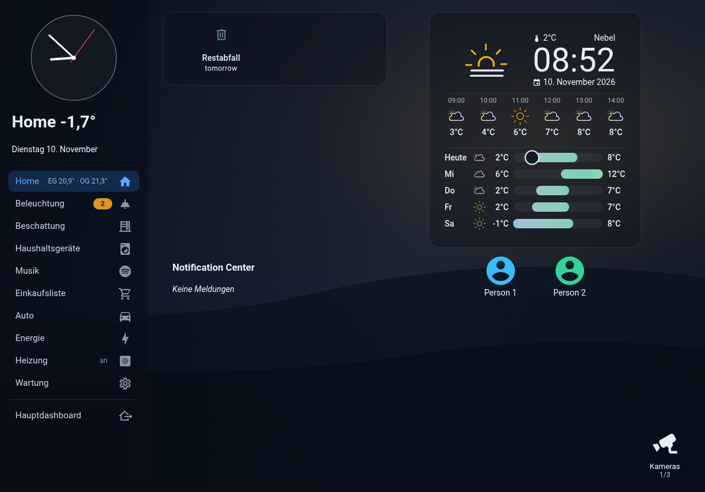
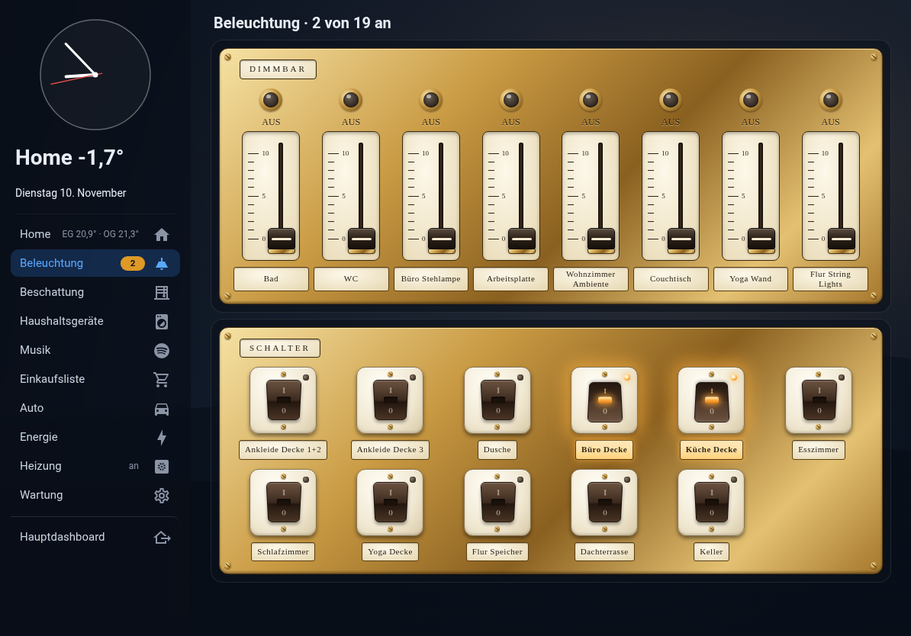
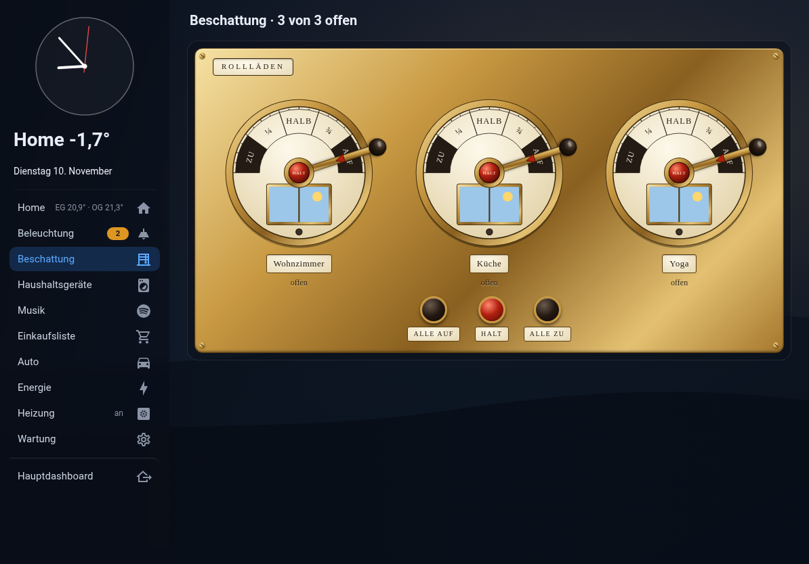
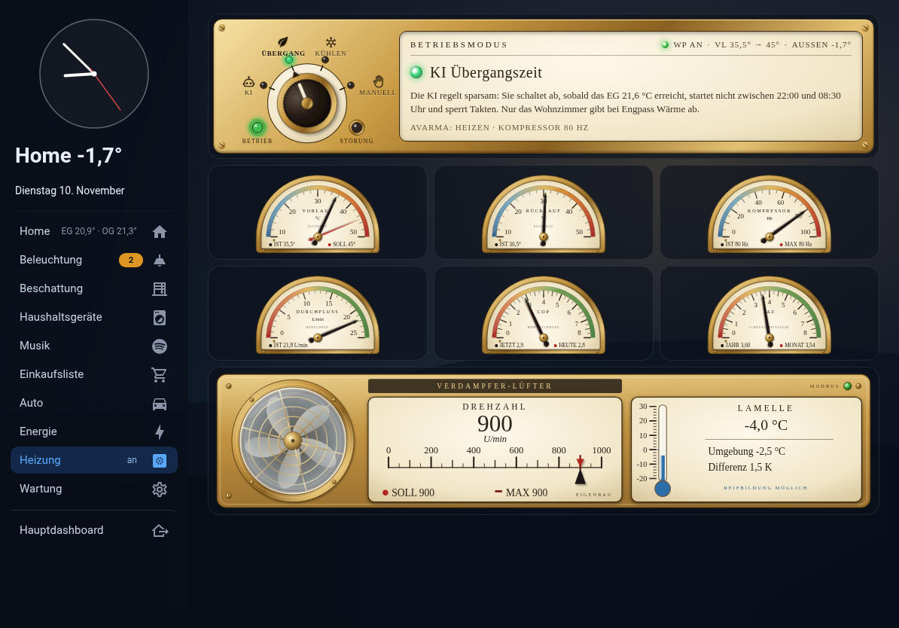
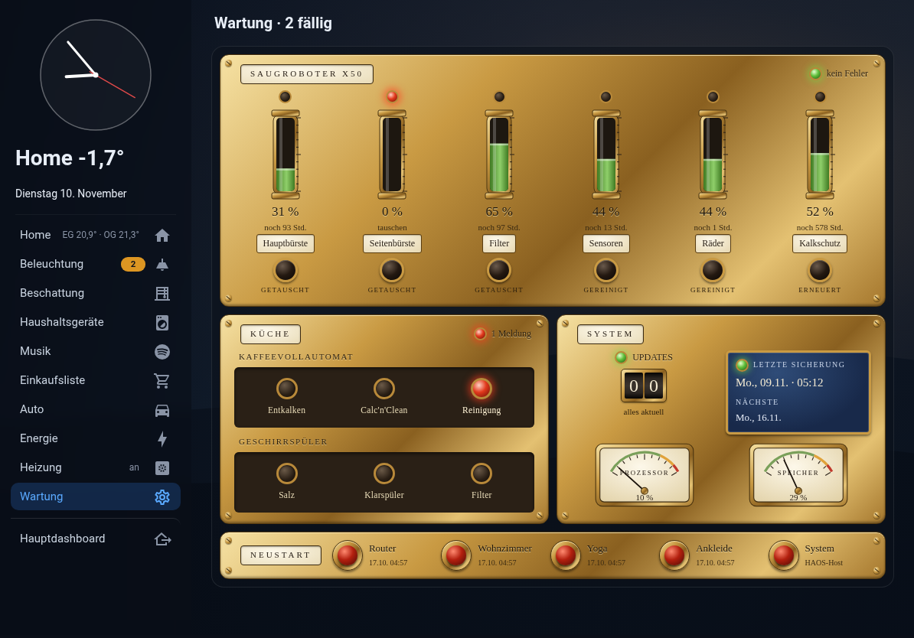
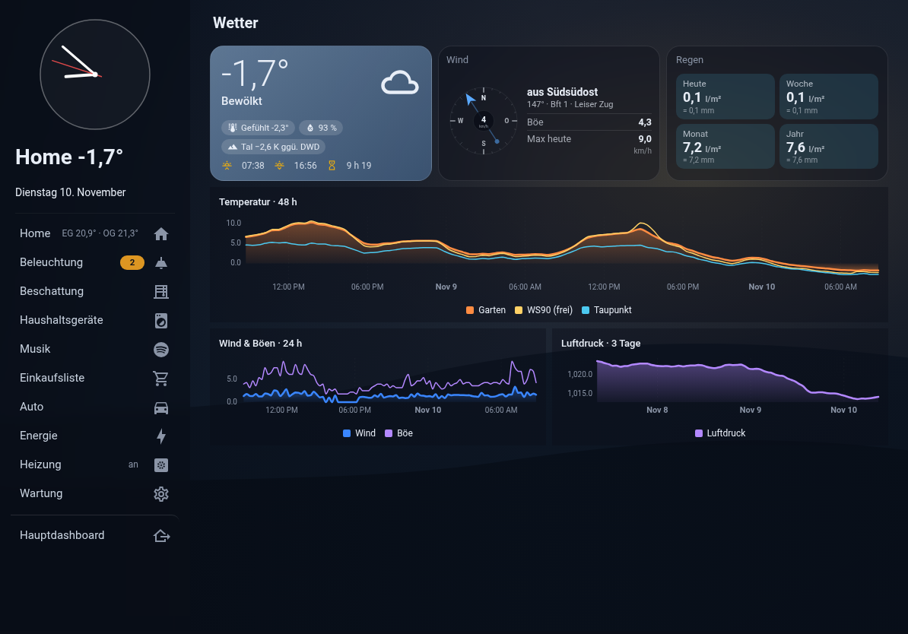

# iPad-Wandpanel für Home Assistant

Ein Home-Assistant-Dashboard für ein fest montiertes iPad (Querformat, 11" und mini).
Links steht eine feste Seitenleiste mit Analoguhr, Außentemperatur, Datum und Navigation.
Rechts liegen freistehende Karten auf einem Vollbild-Hintergrund, der täglich das
Bing-Bild des Tages sein kann. Ein Teil der Bedienelemente ist im Messing-Retro-Stil
gebaut: Drehregler, Kippschalter, Maschinentelegraf und Manometer.

**Das ist eine grobe Vorlage, kein fertiges Produkt.** Das Dashboard stammt aus einer
echten Installation und wurde für die Veröffentlichung bereinigt. Alle Entity-IDs
sind Beispiele und müssen an das eigene System angepasst werden. Die eigenen Karten
(`www/`) funktionieren dagegen unabhängig davon und lassen sich einzeln übernehmen.



| | |
|---|---|
|  |  |
|  |  |
|  | |

## Inhalt

| Pfad | Was |
|---|---|
| `dashboard/ipad-home.yaml` | Komplettes Dashboard mit 10 Ansichten (Home, Beleuchtung, Beschattung, Haushaltsgeräte, Musik, Auto, Energie, Heizung, Wartung, Wetter) |
| `www/ipad/panel-layout.js` | `custom:ipad-panel-layout`: das Seitenleisten-Layout samt Navigation, Hintergrund, Pop-up-Dialogen und Standby-Bild. Außerdem `custom:ipad-rahmen`, ein schlichter Kartenrahmen |
| `www/ipad/analog-clock.js` | `custom:ipad-analog-clock`: schlichte SVG-Analoguhr |
| `www/ipad/retro-licht-card.js` | `custom:retro-licht-card`: Dimmer-Schieberegler und Kippschalter im Messingrahmen |
| `www/ipad/retro-rollladen-card.js` | `custom:retro-rollladen-card`: Rollläden als Maschinentelegraf |
| `www/ipad/retro-wartung-card.js` | `custom:retro-wartung-card`: Wartungstafel (Verschleißteile, Meldeleuchten, Updates/Backup, Neustart-Taster) |
| `www/heizung/retro-gauge-card.js` | `custom:retro-gauge-card`: Zeigerinstrument (Ist/Soll) |
| `www/heizung/retro-luefter-card.js` | `custom:retro-luefter-card`: Lüfter einer Wärmepumpen-Außeneinheit |
| `www/heizung/wp-modus-card.js` | `custom:wp-modus-card`: Betriebsmodus-Drehschalter einer Wärmepumpe |
| `www/ipad/beispiel-hintergrund.svg` | Neutraler, frei verwendbarer Hintergrund |
| `themes/ipad_panel/ipad_panel.yaml` | Dunkles Theme (Marineblau, Bernstein als Akzent) |
| `appdaemon/apps/` | AppDaemon-App, die täglich das Bing-Bild nach `www/ipad/bg_today.jpg` lädt |

Welche Optionen eine Karte kennt, steht jeweils im Kommentarkopf der JS-Datei.

Die Heizungsansicht und ihre drei Karten passen zu einer Hofman-Avarma-Wärmepumpe mit
eigener Regelung, siehe [avarma-eigenbau-regelung](https://github.com/holle74/avarma-eigenbau-regelung).
Für andere Anlagen dient sie nur als Anschauungsbeispiel.

## Voraussetzungen

Über HACS:

- [button-card](https://github.com/custom-cards/button-card) (wird viel benutzt, auch für die Vorlage `akku_kachel`)
- [card-mod](https://github.com/thomasloven/lovelace-card-mod)
- [kiosk-mode](https://github.com/NemesisRE/kiosk-mode) (blendet Kopfzeile und HA-Seitenleiste auf dem iPad aus)
- [Bubble Card](https://github.com/Clooos/Bubble-Card)
- [clock-weather-card](https://github.com/pkissling/clock-weather-card)
- [trash-card](https://github.com/idaho/hassio-trash-card)
- [Statistics Graph Chart Card](https://github.com/cataseven/Statistics-Graph-Chart-Card)
- [custom-sonos-card](https://github.com/punxaphil/custom-sonos-card) (Musik)
- optional, je nach Gerät: dreame-vacuum-map-card (Saugroboter), bmw-cardata-vehicle-card (Auto)

Für das Bild des Tages wird das AppDaemon-Add-on gebraucht. Ohne AppDaemon trägt man
einfach ein festes Bild als `background` ein.

## Einrichten

1. **Karten kopieren:** `www/ipad/` und `www/heizung/` nach `/config/www/` kopieren.
2. **Ressourcen eintragen** (Einstellungen → Dashboards → ⋮ → Ressourcen, Typ *JavaScript-Modul*):
   ```
   /local/ipad/panel-layout.js?v=1
   /local/ipad/analog-clock.js?v=1
   /local/ipad/retro-licht-card.js?v=1
   /local/ipad/retro-rollladen-card.js?v=1
   /local/ipad/retro-wartung-card.js?v=1
   /local/heizung/retro-gauge-card.js?v=1
   /local/heizung/retro-luefter-card.js?v=1
   /local/heizung/wp-modus-card.js?v=1
   ```
   Nach jeder Änderung an einer JS-Datei die Zahl hinter `?v=` hochzählen. Sonst
   behält das iPad die alte Fassung im Cache.
3. **Theme:** `themes/ipad_panel/` nach `/config/themes/` kopieren. In der
   `configuration.yaml` muss `frontend: themes: !include_dir_merge_named themes`
   stehen. Danach *Themes neu laden* aufrufen.
4. **Bild des Tages (optional):** `bing_wallpaper.py` in den AppDaemon-Ordner `apps/`
   kopieren und den Block aus `appdaemon/apps/apps.yaml` in die eigene `apps.yaml`
   übernehmen. Die App lädt das Bild täglich um 05:30 und beim Start herunter und
   setzt `sensor.bing_wallpaper` (Titel und Copyright für die Bildzeile).
5. **Dashboard anlegen:** Neues Dashboard mit der URL `ipad-home` anlegen, dann
   ⋮ → *Bearbeiten* → ⋮ → *Rohdaten-Konfigurationseditor* und den Inhalt von
   `dashboard/ipad-home.yaml` einfügen. Bei einer anderen URL `nav_base` in jeder
   Ansicht anpassen.
6. **Entities anpassen:** Die Beispiel-IDs (z. B. `light.wohnzimmer`,
   `person.person_1`, `calendar.abfallkalender`) durch die eigenen ersetzen.
   Nicht benötigte Ansichten löschen und den passenden Eintrag aus `nav` entfernen.
   Die Navigation ist in jeder Ansicht identisch, damit sie überall gleich aussieht.
7. **Kiosk-Mode:** Unter `kiosk_mode` den HA-Benutzer des iPads eintragen.
   Mit `?disable_km` an der URL kommt man wieder an die normale Oberfläche.

Die Haushaltsgeräte-Ansicht erwartet Produktbilder unter `/local/ipad/bilder/`
(`kaffeevollautomat.jpg`, `kochfeld.jpg`, `geschirrspueler.jpg`). Sie sind wegen der
Bildrechte nicht enthalten.

## Was beim Bauen gelernt wurde

- **card-mod greift nicht an Containerkarten.** `horizontal-stack` und `grid` haben
  keine eigene `ha-card`, und genau dort hängt card-mod seine Styles ein. Spaltenbreiten
  ließen sich darüber nicht setzen. Deshalb gibt es die eigene Layout-Karte mit
  schlichtem CSS-Grid.
- **Kein `filter: drop-shadow` auf den Inhaltsbereich.** Das macht Karten mit eigenem
  Hintergrund unlesbar, und `backdrop-filter` in Kindkarten greift dann ins Leere.
  Die Lesbarkeit vor hellen Bildern kommt über `background_overlay`.
- **Pop-ups:** Das Pop-up von Bubble Card hängt sein Overlay in den View-Container und
  bleibt aus dem Shadow-DOM der Layout-Karte heraus unbedienbar. Die Layout-Karte
  bringt deshalb eigene Dialoge mit (`dialogs`, natives `<dialog>`, geöffnet per
  `navigate` auf `#name`).
- **Täglich wechselndes Hintergrundbild:** Der Dateiname bleibt gleich, deshalb hängt
  die Layout-Karte einen Tagesstempel an die URL. Sonst zeigt Safari tagelang das alte Bild.
- **Standby:** Mit `standby_after` legt sich nach x Minuten ein dunkles Bild mit Uhr
  über das Panel. Die erste Berührung weckt nur auf und schaltet nichts darunter.

## Lizenz

MIT, siehe [LICENSE](LICENSE). Der Beispiel-Hintergrund ist frei verwendbar. Für das
Bing-Bild des Tages gelten die Rechte des jeweiligen Fotografen. Es wird nur lokal
angezeigt und gehört nicht in ein Repository.
